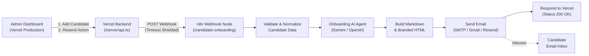

# 🚀 Kodewar Technologies — Automated Candidate Onboarding with n8n & AI Agent

This guide provides the complete, step-by-step setup instructions to automate candidate onboarding emails using **n8n**, an **AI Agent**, and your **Vercel-hosted Kodewar LMS**.

---

## 📌 Architecture Overview

Whenever an administrator performs either of the two candidate actions in the Kodewar LMS dashboard:
1. **Fills "Add New Candidate" form and clicks "Add Candidate"**
2. **Clicks "Resend" option in candidate row actions or profile drawer**

The Vercel production backend securely dispatches a structured JSON payload to your active **n8n Webhook**, which runs an AI Agent to personalize the communication and delivers the onboarding email with the exact required credentials and format.



---

## 📧 Email Template Delivered to Candidates

The workflow formats and delivers the exact template you specified, both in **Plain Text / Markdown** and **Responsive Branded HTML**:

```markdown
Hi {{user_name}},

Welcome to **Kodewar Technologies!** 🎉

We're excited to have you join us as an intern. We're looking forward to being part of your learning journey and helping you grow your skills.

### Your Account Details

**Username:** {{user_name}}  
**Course:** {{user_course}}  
**Email:** {{user_email}}  
**Temporary Password:** {{temp_password}}

### Important: Activate Your Account

To activate your account, please log in using the credentials above and **change your temporary password immediately**.

For security reasons, we recommend choosing a strong and unique password.

We're happy to have you on board. Wishing you an exciting and successful internship journey with Kodewar Technologies!

Best Regards,  
**Team Kodewar Technologies**  
*Learn. Build. Grow.*
```

---

## 🛠️ Step 1: Import `workflow.json` into n8n

The pre-built workflow file is located in the root of your project: [`workflow.json`](./workflow.json).

1. Log into your **n8n instance** (Self-hosted Docker, n8n Cloud, Railway, Render, etc.).
2. Go to **Workflows** in the left sidebar.
3. In the top right corner, click the **three dots (`...`)** and select **Import from File**.
4. Choose the [`workflow.json`](./workflow.json) file from this repository.
5. You will see the complete canvas containing:
   - **Candidate Onboarding Webhook** (Trigger)
   - **Validate & Prepare Candidate** (Code Node)
   - **Onboarding AI Agent** (LangChain Agent Node)
   - **Google Gemini Chat Model** (AI Model Node)
   - **Build Email Markdown & HTML** (Template Engine)
   - **Send Onboarding Email** (Email / SMTP Node)
   - **Respond to Vercel LMS** (Webhook Response Node)

---

## 🔑 Step 2: Configure Credentials in n8n

### 2.1 AI Agent Model Credential
Double-click the **Google Gemini Chat Model** node:
1. Under **Credential for Google Gemini API**, click **Create New Credential**.
2. Enter your **Google Gemini API Key** (obtainable free from [Google AI Studio](https://aistudio.google.com/)).
3. Click **Save**.

> *Note: If you prefer OpenAI, delete the Google Gemini node, add the **OpenAI Chat Model** node, connect it to the `ai_languageModel` socket on the AI Agent, and attach your OpenAI API key.*

### 2.2 Email Sending Node Credential
Double-click the **Send Onboarding Email** node:
1. Select or create your email provider credentials:
   - **Standard SMTP / Hostinger / Zoho / AWS SES**: Enter Host, Port (`465` or `587`), User, and Password.
   - **Gmail SMTP**:
     - Host: `smtp.gmail.com`
     - Port: `465` (SSL/TLS)
     - User: `your-email@gmail.com`
     - Password: Use a [Google App Password](https://myaccount.google.com/apppasswords) (16-character code).
   - **From Email**: Set to your verified sender address (e.g. `onboarding@kodewar.com` or your Gmail address).

---

## 🌐 Step 3: Get Your Production Webhook URL

1. Double-click the **Candidate Onboarding Webhook** node in n8n.
2. Note the Webhook paths:
   - **Test URL**: `https://<your-n8n-domain>/webhook-test/candidate-onboarding`
   - **Production URL**: `https://<your-n8n-domain>/webhook/candidate-onboarding`
3. Click the toggle switch at the top right of the n8n canvas from **Inactive** to **Active** (Turn workflow ON).

---

## ⚙️ Step 4: Configure Vercel Production Environment

To connect your deployed Kodewar LMS with n8n:

1. Go to your [Vercel Dashboard](https://vercel.com).
2. Select your `kodewar-digital-learn` project.
3. Navigate to **Settings** → **Environment Variables**.
4. Add the following variables:

| Variable Name | Example Value | Description |
| :--- | :--- | :--- |
| `N8N_WEBHOOK_URL` | `https://n8n.yourdomain.com/webhook/candidate-onboarding` | Your active n8n production webhook URL |
| `N8N_WEBHOOK_SECRET` | `kodewar_secret_prod_987654` | *(Optional)* Shared secret token sent in `x-webhook-secret` header |
| `APP_URL` | `https://kodewar.vercel.app` | Production URL of your deployed application for login links |

5. Click **Save** and trigger a **Redeploy** on Vercel so the serverless functions pick up the new environment variables.

---

## 🧪 Step 5: Testing & Verification

### Test Method 1: In the Kodewar LMS Admin UI
1. Log in as an Administrator in your Kodewar LMS.
2. Go to the **Candidates** tab.
3. Click **Add Candidate**.
4. Fill in the candidate details (Name, Email, Course, Batch).
5. Click **Add Candidate**:
   - The backend creates the candidate profile and generates a temporary password.
   - The backend automatically calls the n8n webhook.
   - A success banner confirms: `Candidate created successfully. (Automated onboarding email triggered via n8n)`.
6. Test the **Resend** action:
   - On any candidate row in the table, click the **Mail icon (Resend)** in the Actions column.
   - Or open the candidate details drawer and click **Resend Onboarding Email (via n8n)**.
   - A newly generated temporary password is saved and immediately dispatched via n8n.

### Test Method 2: Command Line Test (cURL / PowerShell)
You can directly test your n8n webhook endpoint with cURL:

```bash
curl -X POST "https://<your-n8n-domain>/webhook/candidate-onboarding" \
  -H "Content-Type: application/json" \
  -d '{
    "event_type": "candidate_created",
    "user_name": "Aarav Sharma",
    "user_course": "Full Stack Web Development",
    "user_email": "your-test-email@example.com",
    "temp_password": "Pass@2026",
    "candidate_id": "KDL-2026-001",
    "login_url": "https://kodewar.vercel.app/login"
  }'
```

### Test Method 3: In n8n Canvas
1. In n8n, the webhook node already contains pre-configured **Mock Data** (`pinData`).
2. Click **Test step** on the **Validate & Prepare Candidate** node.
3. Click **Execute step** on subsequent nodes to view the generated email content and test delivery directly.

---

## 🛡️ Vercel Production Best Practices

- **Timeout Shielding**: The backend uses an `AbortController` with an 8-second ceiling. If your n8n instance experiences temporary latency or downtime, the LMS will not freeze or crash, and candidate creation will complete safely.
- **Auditing & Outbox**: Every trigger is recorded in the local LMS audit log and email log table with timestamps.
- **Fail-Safe AI Fallback**: If the AI model key reaches rate limits, the template code node automatically ensures the candidate still receives the exact required email without delay.

